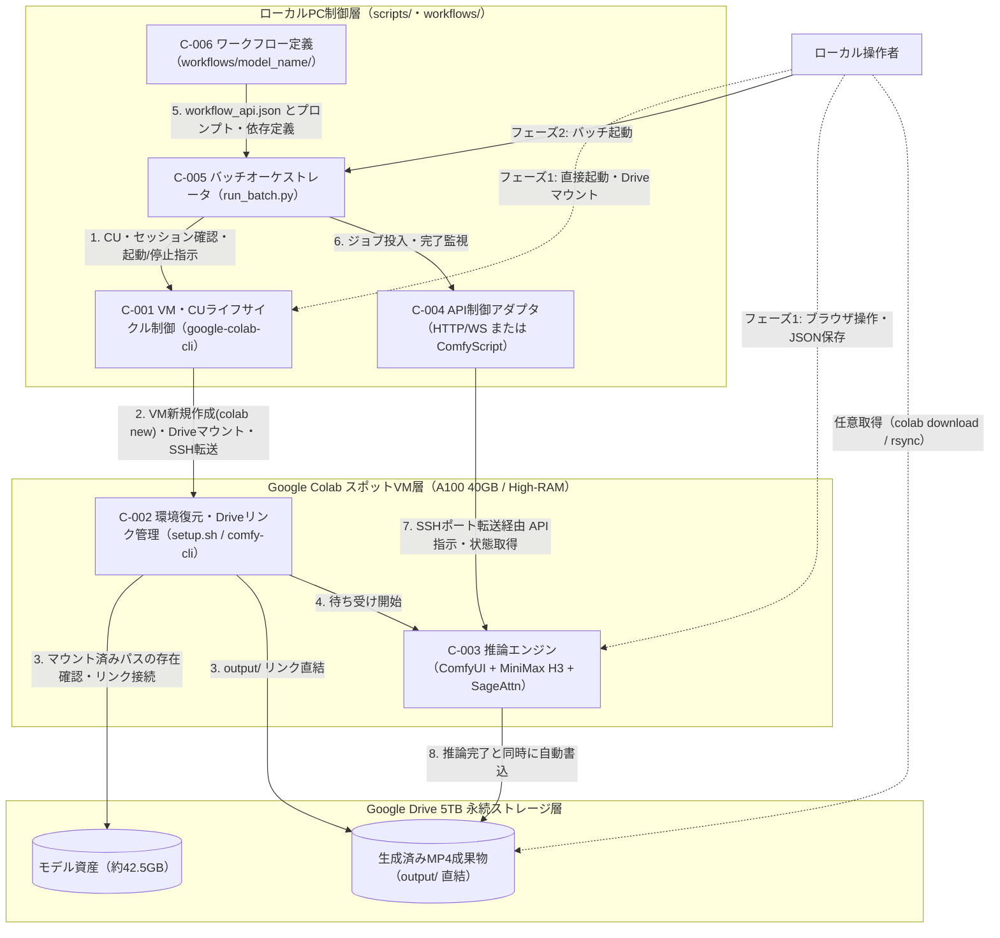

# 基本設計書（基本仕様・システム全体アーキテクチャ定義）
**Google Colab CLI × ComfyUI（MiniMax H3）動画自動生成パイプライン（colab-cli-comfyui-runner）**

---

## 1. 概要と基本方針

### 1.1 システム目的と対象範囲

本システムは、Google AI Pro 契約に付帯する計算資源（月間 200 CU）およびストレージ（Google Drive 5TB）を活用し、ローカルPCから `google-colab-cli`（SSH）経由で Google Colab 上の ComfyUI および MiniMax H3 を制御し、音声付き動画をスポット実行・無人バッチ生成するための基盤である。

- **対象範囲**:
  - ローカルPCからの Colab GPU インスタンス（A100 40GB / High-RAM）の起動・CU監視・確実な停止制御（FR-01, FR-07）
  - Google Drive マウントとシンボリックリンクによるモデル資産（約42.5GB）および出力動画の即時永続化・必要時のローカル取得（FR-02, FR-06）
  - SSH ポートフォワーディング（`localhost:8188`）経由の ComfyUI Web UI 操作・実測ベンチマーク・API用 JSON 抽出（FR-03）
  - MiniMax H3（量子化モデル＋Turbo LoRA＋高速化アテンション）による音声付き動画（4〜15秒・24fps・32kHzステレオ音声付きMP4）の生成（FR-04）
  - ローカルバッチ制御による 5〜10 本単位の無人連続生成（FR-05）
  - `scripts/`（共通基盤）と `workflows/<model_name>/`（モデル別定義）の分離による将来的な別モデル（Wan 2.2、LTX-2.5 等）への差し替え対応（FR-08）
- **対象外範囲**:
  - 24時間365日の常駐 Web サーバ・常時待ち受け推論 API としての運用
  - マルチ GPU 構成によるフル精度（BF16）モデルの分散推論
  - MiniMax ホスト型 API 専用機能（`H3-Regenerate-2K`、`H3-Context-IR`）
- **利用者・外部システム**:
  - **利用者**: ローカルPCの操作者（xzyozi）
  - **外部システム**: Google Colab（VM・OAuth・CU課金管理）、Google Drive（5TB永続ストレージ）、ComfyUI / MiniMax H3 OSS 群
- **前提・制約**: ハードウェア、契約、ネットワーク、ライセンスおよびローカル端末前提の正本は [CCR-ENV-001 環境・開発基盤仕様書](../setup/CCR-ENV-001_環境・開発基盤仕様書.md) とする。
- **主要な非機能要件**: 下表に定める。

| ID | 区分 | 要件 | 目標値・基準 | 測定方法・確認先 | 正本 |
| :--- | :--- | :--- | :--- | :--- | :--- |
| `NFR-001` | 性能 | 環境復元時間 | VM起動からComfyUI待ち受け完了まで3分以内（モデル事前配置済み前提） | フェーズ1起動ログの実測時刻差分 | 本書 / CCR-ENV-001 |
| `NFR-002` | 性能 | 推論所要時間（2本目以降） | テスト設定（960x544 / 5秒 / 8step）1.5〜2.5分/本、本番設定（1344x768 / 10秒 / 8step + SageAttn）3〜5分/本 | ComfyUI実行履歴・バッチ実行ログ | 本書 |
| `NFR-003` | コスト | 月間稼働・CU枠管理 | 月間200 CU枠でA100を約30〜37時間/月稼働（標準設定で月間250〜450本目安）、未消化CUの繰越不可を前提に管理 | `colab usage` 実行前後差分と月次集計 | CCR-ENV-001 / 本書 |
| `NFR-004` | 可用性 | セッション制限耐性 | 最大24時間連続上限・アイドル切断（60〜90分）を前提に、1バッチを2〜4時間以内で完結 | バッチ単位の実行時間上限設定とログ確認 | 本書 |
| `NFR-005` | 耐障害性 | 障害時のデータ保全 | VM強制終了・エラー発生時も、生成済みMP4およびモデル資産がGoogle Drive側に残存 | Drive `output/` シンボリックリンク直結の検証 | 本書 |
| `NFR-006` | 安全回路 | 課金暴走防止 | 正常終了・異常終了・割込のいずれでも必ず `colab stop` を実行 | `try ... finally` / `trap` 制御の終了確認、`colab sessions`（アクティブセッション空確認）および `colab usage` | 本書 |
| `NFR-007` | 法務・認証 | 認証・ライセンス遵守 | 対話型OAuth初回認証のローカル保持、MiniMax H3 Community License遵守 | 初回構築確認および帰属表示・利用条件チェック | CCR-ENV-001 |

品質ゲートの実行条件および合格基準は [CCR-ENV-001 環境・開発基盤仕様書](../setup/CCR-ENV-001_環境・開発基盤仕様書.md) 4.4 を正本とし、本書では参照先のみを定める。テストケースと実行結果は今後作成するテスト計画・結果報告書へ委譲する。

### 1.2 アーキテクチャ基本原則と課題解決

| # | 課題・ボトルネック | 優先度 | 解決方針・選定技術 | 選定理由・トレードオフ | 担当コンポーネント | 関連文書 |
| :--- | :--- | :---: | :--- | :--- | :--- | :--- |
| 1 | 待機課金（CU空費）とColab常駐不可制約 | 高 | 必要時起動 → 連続バッチ → 即時 `colab stop` の使い捨てスポット実行型 | 常駐時の待機CU消費をゼロ化できる。都度環境復元の手間が生じるため `C-002` の高速復元で相殺する | `C-001`, `C-005` | CCR-ENV-001 |
| 2 | 毎回約42.5GBのモデル再ダウンロードによる時間・帯域ロス | 高 | Google Drive 5TB永続領域へのモデル事前配置とシンボリックリンク接続 | 環境復元時間を3分以内に抑えられる。Drive I/O依存はあるがローカル再送より大幅に高速 | `C-002`, `C-006` | CCR-ENV-001 |
| 3 | 自前コードの肥大化と保守コスト増大 | 高 | 既存OSS（`google-colab-cli`, `ComfyUI`, `comfy-cli`, `MiniMax-H3_ComfyUI_repackaged`, `SageAttention`/TeaCache）最大活用＋薄いグルーコード（`setup.sh` / `run_batch.py`） | 推論・SSHプロキシ等の複雑処理をOSSへ委譲し、自前実装をライフサイクルとバッチ投入のみに限定できる | 全コンポーネント | 本書 2.2 |
| 4 | A100 40GB単一GPUでの動画＋音声同時推論のVRAM/RAM不足と低速化 | 高 | INT8/NVFP4量子化モデル＋Turbo 8step LoRA＋SageAttention/TeaCache＋High-RAM（64GB以上）必須化 | 単一A100での実時間生成（本番3〜5分/本）を可能にする。フル精度BF16比の微小劣化を許容し実用性を優先 | `C-003` | CCR-ENV-001 |
| 5 | 実測CU単価・所要時間の不確実性による月間200 CU超過リスク | 中 | 段階的導入（フェーズ1: GUI検証＋2本実測ベンチマーク → フェーズ2: 本番バッチ移行） | 事前見積りの誤差をフェーズ1の実測で排除してから無人バッチの本数を確定できる | `C-001`, `C-005` | 本書 4章 |
| 6 | 将来的な新モデル（Wan 2.2 / LTX-2.5 等）への切替困難 | 中 | `scripts/`（共通基盤）と `workflows/<model_name>/`（モデル別定義）のディレクトリ分離 | 共通ライフサイクル制御を改修せずにモデル・ワークフロー定義を差し替えられる | `C-005`, `C-006` | 本書 4章 |

### 1.3 本書のSSOT範囲と文書境界

- **本書の正本範囲**: `system_architecture`。システム全体の目的、アーキテクチャ、コンポーネント分割、システム境界、安全回路方針を定義する。
- **詳細設計との境界**: 各スクリプト・モジュールの関数契約、引数・戻り値 DTO、APIポーリング/リトライの具体的制御フローおよび状態遷移条件は詳細設計書（DD・今後作成）を正本とする。
- **データ構造仕様との境界**: プロンプト定義ファイル、ジョブ結果記録、ワークフローテンプレートの置換スキーマ、Driveディレクトリ配置および排他/原子書き込み仕様はデータ構造仕様書（DS・今後作成）を正本とする。
- **環境・運用文書との境界**: プラットフォーム制約・ツールチェーン・品質ゲートの正本は [CCR-ENV-001 環境・開発基盤仕様書](../setup/CCR-ENV-001_環境・開発基盤仕様書.md) とし、フェーズ1・フェーズ2の具体的な実行手順は手順書（SETUP/OP・今後作成）を正本とする。
- **全体ルール**: 文書分類、Frontmatter、ライフサイクル、矛盾時の解決手順は [ドキュメントガバナンス](../README.md) を正本とする。

---

## 2. システム全体アーキテクチャとコンポーネント分離

### 2.1 全体構造とデータフロー

本システムは、**ローカルPC制御層**、**SSHトンネル／リモート実行境界**、**Google Colab GPU実行層**、**Google Drive永続化層**の4層で構成される。ローカル側がVMの起動・Driveマウントからバッチ投入・停止までを主導し、Colab側はステートレスな計算ノードとして動作し、永続資産と成果物はすべてGoogle Drive側へ直結して保全する。

下図において、実線（`-->`）はフェーズ2（無人バッチ）の標準データ・制御フロー、破線（`-.->`）はフェーズ1（GUI手動検証・任意取得）の導線を示す。

### 2.2 コンポーネント責務マッピング

| コンポーネントID | コンポーネント名 | 担当領域・主要責務 | 依存先・依存方向 / 公開インターフェース | 関連詳細設計書 |
| :--- | :--- | :--- | :--- | :--- |
| `C-001` | VM・CUライフサイクル制御 | `google-colab-cli` を用いたCU残高確認（`colab usage`）、アクティブセッション確認（`colab sessions`）、A100 High-RAM VMの新規作成（`colab new`）、Driveマウント実行（`colab drivemount`）、SSHポート転送確立、確実な停止（`colab stop` / `--rm`） | `google-colab-cli` / OpenSSH に依存。`C-005` へライフサイクル操作I/Fを提供 | CCR-DD-001（作成予定） |
| `C-002` | Colab環境復元・Driveリンク管理 | Colab VM上での `comfy-cli`（`uv`連携）によるComfyUI構築、高速化ライブラリおよびモデル別依存定義の汎用適用、マウント済みDriveパス（`/content/drive/MyDrive/...`）の存在チェックとモデル/`output/` シンボリックリンク作成 | マウント済みGoogle Drive領域・`comfy-cli` に依存。`C-001` による `colab drivemount` 完了後にSSH経由で起動される | CCR-DD-001（作成予定） |
| `C-003` | 推論エンジン・モデル実行基盤 | ComfyUIサーバ待ち受け、MiniMax H3（FL2VA/Ref2VA量子化＋Qwen3VL＋Video/Audio VAE＋Turbo LoRA）および SageAttention / TeaCache によるMP4生成 | `C-002` が構築したリンク先（モデル・出力）を参照。`localhost:8188` でHTTP/WS APIおよびWeb UIを公開 | CCR-DD-001（作成予定） |
| `C-004` | ワークフロー・API制御アダプタ | SSHポート転送越しに ComfyUI API（標準HTTP/WS API または `ComfyScript`）へテンプレートJSON＋パラメータを投入し、進捗・完了・エラーを監視 | `C-003`（`localhost:8188`）へ接続。`C-005` からジョブ投入単位で呼び出される | CCR-DD-001（作成予定） |
| `C-005` | バッチオーケストレータ | 起動前CU・セッションチェック、VM起動、Driveマウント指示、環境復元呼び出し、5〜10本単位の連続投入ループ、処理時間監視、正常/異常終了時の `colab stop` 保証を統括 | `C-001`, `C-004`, `C-006` を統合制御。ローカル操作者のCLIエントリポイント | CCR-DD-001（作成予定） |
| `C-006` | ワークフロー定義・成果物管理 | `workflows/<model_name>/` 配下のAPI用JSON・モデル固有パラメータ・モデル固有のカスタムノード/追加Pythonパッケージ依存定義管理、および Drive `output/` 直結と必要時の `colab download` / `scp` / `rsync` 取得導線 | モデル実体はDrive永続領域を参照。`C-005` へモデル定義を提供し、モデル差し替え境界を担う | CCR-DS-001（作成予定） |

※ API制御方式（標準HTTP/WS API と `ComfyScript` のどちらを第一実装とするか）の比較・決定は、詳細設計フェーズまたはADRにて確定する。

---

## 3. 動作前提およびシステム境界

### 3.1 実行前提環境

- **対応OS・ランタイム要件・依存管理の正本**: [CCR-ENV-001 環境・開発基盤仕様書](../setup/CCR-ENV-001_環境・開発基盤仕様書.md) 2章および4.1〜4.2章に従う。
- **実行エントリポイント**:
  - **フェーズ1（GUI検証）**: ローカル操作者が `google-colab-cli`（`colab new`・`colab drivemount` 等）でVM確保・Driveマウント・SSHポート転送を張り、ブラウザで `localhost:8188` にアクセスして操作する。
  - **フェーズ2（無人バッチ）**: ローカル制御スクリプト（`run_batch.py`）をCLIから起動し、VM確保（`colab new`）〜Driveマウント（`colab drivemount`）〜Colab側 `setup.sh` 実行〜連続推論〜自動停止（`colab stop`）までを一括実行する。
- **品質目標・品質ゲート**: 本システムはコード・ドキュメントの品質保証として [CCR-ENV-001 環境・開発基盤仕様書](../setup/CCR-ENV-001_環境・開発基盤仕様書.md) 4.4 に定義された品質ゲート（`QG-001`〜`QG-006`、およびOpt-inの `QG-007`）を適用する。

### 3.2 安全回路・システム境界方針

- **外部アクター・外部システム**: ローカル操作者、Google認証基盤（OAuth）、Google Colab実行基盤、Google Drive、各種OSSリポジトリ（起動時セットアップ取得元）。
- **入出力と信頼境界**:
  - ローカル側の入力（プロンプト一覧、パラメータ、API用ワークフローJSON）とColab VM上の推論実行空間はSSH境界で分離する。
  - ワークフローJSONへのパラメータ注入時は、実行前にモデル種別・必須パラメータ範囲（尺4〜15秒等）をローカル側で事前検証し、不正入力による長時間ジョブ失敗やCU浪費を防ぐ。
- **認証・認可境界**:
  - Google OAuth認証は初回に対話型ターミナルで完了させ、認証情報をローカル端末へ安全に保持する。
  - Colab VMへのSSH接続は `ed25519` 鍵認証のみを許可し、ComfyUIサーバはローカルループバック限定（SSHポート転送経由）として外部インターネットへ直接公開しない。
- **タイムアウトと再試行制御**:
  - Colabの最大24時間連続上限およびアイドル切断（60〜90分）を踏まえ、1回のバッチ起動は **2〜4時間以内（目安5〜10本）** で完了するよう上限を設ける。
  - VM起動・ComfyUI待ち受け待機および単一ジョブ推論にはタイムアウト上限を設け、無応答ハングによるCU空費を防止する。
  - 一時的なAPI通信瞬断に対しては有限回数の再試行を許容し、無限ループを禁止する。
- **排他制御・競合防止**:
  - Google AI Pro 単一契約の200 CU枠および単一A100スポット枠での運用を前提とし、ローカル側から同一契約に対する多重バッチ同時起動を抑止する（起動前の `colab usage` / `colab sessions` 確認およびロック方針はDD/DSで具体化）。
- **失敗時保全契約**:
  - **課金暴走防止**: ローカルオーケストレータ（`C-005`）およびシェルスクリプトは `try ... finally` または `trap` を必ず組み込み、推論エラー・タイムアウト・ユーザー割込（SIGINT等）のいずれで終了しても確実に `colab stop` を実行し、`colab sessions` で残存セッションがないことを確認可能とする。
  - **成果物非破壊**: ComfyUIの `output/` をGoogle Driveへシンボリックリンク直結することで、バッチ途中（例: 10本中4本目完了後）でVMが強制終了されても完了済みMP4はDrive側に保全される。
- **機密情報・監査ログ方針**:
  - OAuthトークン、SSH秘密鍵、ローカル環境固有の絶対パス等はコード・設計書・公開ログへ出力しない。
  - 実行前後の `colab usage` 残高、バッチ開始/終了時刻、ジョブごとの成否・所要時間は監査・CU単価追跡用の実行ログとしてローカルに記録する。

---

## 4. 基本設計における変更管理方針

- **拡張時のルール（モデル非依存構成）**:
  - `scripts/` 配下にはVM制御・SSH接続・API監視・バッチループなどモデル非依存の共通基盤のみを配置する。
  - モデル固有のワークフローJSON（`workflow_api.json`）、モデル配置定義、推論パラメータ既定値に加え、**モデル固有のカスタムノードや追加Pythonパッケージの依存定義（例: `requirements.txt`、`nodes.txt` 等）も `workflows/<model_name>/`（初期対象: `minimax_h3`）配下に同梱できる構成**とする。
  - `C-002`（`setup.sh`）は指定された `workflows/<model_name>/` の依存定義ファイルを汎用的に読み込んで適用するだけとし、Wan 2.2 や LTX-2.5 等の追加時に `setup.sh` や共通基盤側へモデル名による `if` 分岐を漏らさない。
- **段階的導入の設計方針**:
  - **フェーズ1（GUI中心ベンチマーク）**: `colab usage` 記録、初回モデル配置・Driveマウント確認、軽量設定（960x544 / 5秒 / Turbo 8step）で2本連続生成を行い、「初回ロード込み時間」「2本目の純粋推論時間」「実測消費レート（CU/時）」を確定し、`workflow_api.json` を保存する。
  - **フェーズ2（CLI + API自動化）**: フェーズ1で確定した単価・所要時間と月間200 CU上限に基づき、1バッチ5〜10本単位の無人連続生成＋自動停止運用へ移行する。
- **仕様の決定権 (SSOT)**: システム全体方針は本書、具象関数契約・状態遷移は詳細設計書（DD）、永続化・ファイル配置・ロック仕様はデータ構造仕様書（DS）、開発・実行環境制約および品質ゲートは [CCR-ENV-001 環境・開発基盤仕様書](../setup/CCR-ENV-001_環境・開発基盤仕様書.md) を正本とする。
- **変更影響の確認方法**: モデル追加、API制御方式変更、またはColab/CLI仕様変更時は、影響を受ける境界（ENV / BD / DD / DS / ワークフローJSON）の順に上位文書から整合性を確認し、設計変更の判断理由はADRまたは改訂履歴へ記録する。

---

## 5. 作成完了チェック

- [x] 対象範囲・対象外範囲・利用者・前提を記入した。
- [x] 主要な非機能要件を表に記入し、各要件に目標値・測定方法・正本を設定した（品質ゲートは参照のみ）。
- [x] `document_role`、`ssot_scope`、`status`、`owner`をFrontmatterへ設定した。
- [x] 課題ごとに優先度、選定理由、トレードオフ、担当、関連文書を記入した。
- [x] Mermaid図のサンプル名・仮ラベルを実際の構成へ置換した。
- [x] 全コンポーネントの責務、依存方向、公開インターフェース、詳細設計書リンクを記入した。
- [x] 実行環境、依存管理の正本、品質目標と品質ゲートの参照先（環境・開発基盤仕様書）を記入した。
- [x] 外部システム、信頼境界、認証・認可、失敗時保全を記入した。
- [x] 未置換のプレースホルダ、`YYYY-MM-DD`、サンプル固有名が残っていない。

---

## 6. 改訂履歴 (Change Log)

| 版数 | 改訂日 | 変更者 | 変更内容・変更理由 (Why) |
| :--- | :--- | :--- | :--- |
| Rev.1.0 | 2026-11-22 | xzyozi | 要件定義書 Ver 2.0 に基づき初版作成 |
| Rev.1.1 | 2026-11-22 | xzyozi | レビュー指摘反映（`colab new`・`colab drivemount`・`colab sessions` 整合、フェーズ1/2導線明確化、モデル固有依存境界の追加） |
