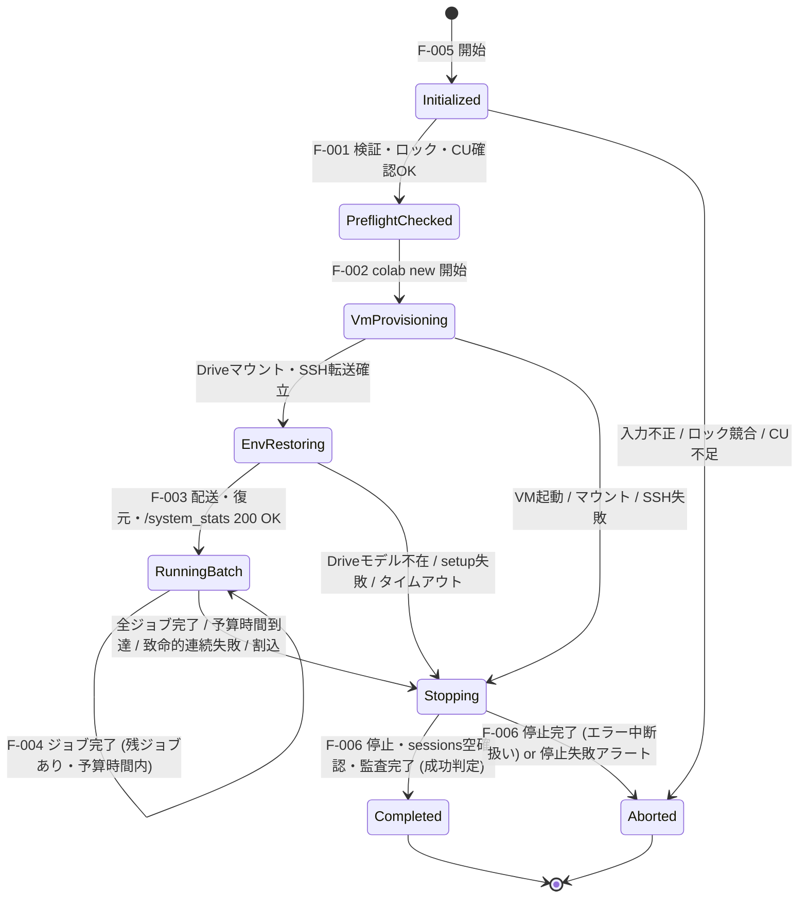
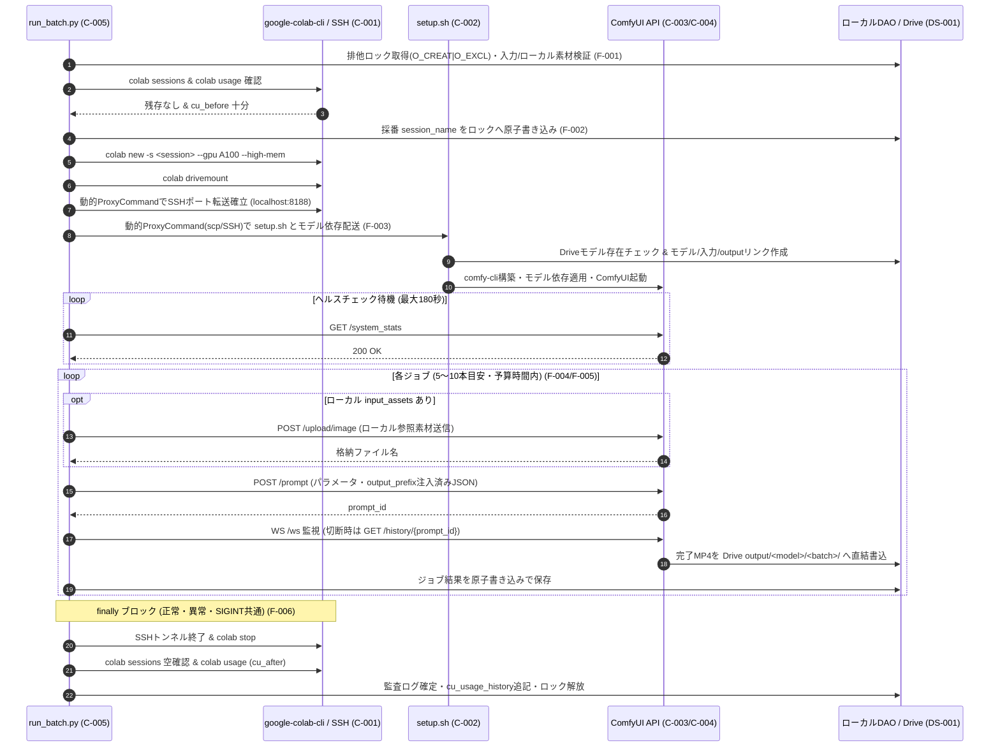

# 詳細設計書（機能・モジュール制御仕様）
**Google Colab CLI × ComfyUI（MiniMax H3）動画自動生成パイプライン（colab-cli-comfyui-runner）**

---

## 1. 概要とSSOT境界

### 1.1 モジュールの目的

本書は、[CCR-BD-001 基本設計書](./CCR-BD-001_基本設計書.md) で定義されたコンポーネント群（`C-001`〜`C-005`）について、フェーズ2（無人バッチ実行）を軸とした具体的なモジュール間インターフェース、メモリ上 DTO 契約、VM配送経路、ComfyUI API 制御フロー、状態遷移、およびエラー対処契約を定義する。

- **API制御方式の位置づけ（`C-004`）**: 外部依存最小化と `workflow_api.json` 直接投入の観点から、標準実装は ComfyUI 標準 HTTP/WS API（`localhost:8188` 上の `/system_stats`, `/upload/image`, `/prompt`, `/ws`, `/history/{prompt_id}`）を採用し、`C-004` のアダプタ境界により将来の `ComfyScript` 等への差し替え余地を保持する。
- **VM配送経路の確定（`C-001` → `C-002`）**: モデル重み（約42.5GB）と出力MP4のみを Google Drive に配置し、`scripts/setup.sh` および `workflows/<model_name>/` の依存定義ファイル（`requirements.txt`, `nodes.txt` 等、数KB）は実行時にローカルPC側から `scp` または SSH 標準入力経由で Colab VM の `/tmp/ccr_setup/` へ配送・実行する。これにより Git 管理下の最新版を常に適用し、Drive 側との二重管理を防止する。

### 1.2 単一責任範囲 (SSOT) とデータ境界

- **本書の正本範囲**: `module_behavior`。関数の呼び出し順序、制御フロー、入出力 DTO、状態遷移ルール、再試行・タイムアウト契約、機能テスト要件の正本とする。
- **データ境界 (DTO vs DAO)**: 本書はモジュール・関数間のメモリ上データ受け渡し（DTO）を管理する。ファイル配置、JSON永続化スキーマ、原子書き込み契約、排他ロックファイル形式は [CCR-DS-001 データ構造仕様書](./CCR-DS-001_データ構造仕様書.md) を正本とする。
- **BDとの関係**: システム全体アーキテクチャ、責務境界、安全回路方針は [CCR-BD-001 基本設計書](./CCR-BD-001_基本設計書.md) を正本とする。
- **他文書へ委譲する情報**: 品質ゲートの実行条件・合格基準は [CCR-ENV-001 環境・開発基盤仕様書](../setup/CCR-ENV-001_環境・開発基盤仕様書.md) 4.4、テストケース・実行結果・証跡はテスト計画・結果報告書（今後作成）を正本とし、本書へ再掲しない。
- **外部公開契約**: 本システムはローカル操作者専用CLIであり、外部向けネットワークAPIを公開しない（`localhost:8188` へのSSHループバック接続のみ）。
- **責務の対象外**: ComfyUI 内部のノード推論実装、`google-colab-cli` の内部実装、およびフェーズ1の手動操作手順（手順書へ委譲）。
- **矛盾時の扱い**: 文書の更新日ではなく、該当する `ssot_scope` の正本を更新し、関連文書を追従させる。

---

## 2. インターフェースと DTO (Data Transfer Object) 仕様

### 2.1 対象機能一覧

| 機能ID | 関数・機能名 | 呼び出し元 | 主な呼び出し先 | 同期 / 非同期 | 冪等性 | 外部副作用 | 公開範囲 |
| :--- | :--- | :--- | :--- | :---: | :---: | :--- | :---: |
| `F-001` | `preflight_and_acquire_lock` | `F-005`（`C-005`） | `C-001`, `CCR-DS-001` ロック/ログDAO | 同期 | なし | ロックファイル作成、`colab usage`/`sessions` 照会 | 内部 |
| `F-002` | `provision_vm_and_tunnel` | `F-005`（`C-005`） | `C-001`（`google-colab-cli`, SSH） | 同期 | なし | Colab VM起動、Driveマウント、SSHポート転送開始 | 内部 |
| `F-003` | `deliver_and_restore_env` | `F-005`（`C-005`） | `C-001`（`scp`/SSH）, `C-002`（`setup.sh`）, `C-004` | 同期 | 条件付き | VM `/tmp/ccr_setup/` 書込、ComfyUI起動、リンク作成 | 内部 |
| `F-004` | `submit_and_monitor_job` | `F-005`（`C-005`） | `C-004`（HTTP/WS API） | 非同期監視 | 条件付き | ComfyUI キュー投入、Drive `output/` へのMP4生成 | 内部 |
| `F-005` | `run_batch_pipeline` | CLIエントリポイント | `F-001`〜`F-004`, `F-006` | 同期統括 | なし | 1バッチ分のVM確保〜連続推論〜安全停止・監査ログ記録 | 内部 |
| `F-006` | `teardown_and_audit` | `F-005`（`finally`句） | `C-001`（`colab stop`/`sessions`/`usage`）, DAO | 同期 | あり | VM停止、SSHプロセス終了、ロック削除、CU差分記録 | 内部 |

### 2.2 主要関数・機能の契約

#### 機能契約（機能ID: `F-001`）

- **対象機能・関数名**: `preflight_and_acquire_lock`（事前検証・排他ロック取得）
- **機能概要**: バッチ入力定義とモデルマニフェストを事前検証（ローカル指定の `input_assets` 実在確認含む）し、`O_CREAT | O_EXCL` で排他ロック（`state/active_batch.lock`）を取得した上で、`colab sessions` による既存アクティブセッション不在および `colab usage` による最低必要CU残高を確認する。
- **事前条件 (Pre-conditions)**: 指定された `batch_spec_path` および対応する `workflows/<model_name>/model_manifest.json` / `workflow_api.json` がローカルに存在すること。
- **事後条件 (Post-conditions)**: 排他ロックが保持され、全ジョブの入力パラメータ・ローカル参照素材が検証済みであり、`PreflightResultDto`（開始前CU残高含む）が返却されること。失敗時は取得済みロックがあれば解放してから例外送出すること。
- **タイムアウト / キャンセル**: `colab usage` / `colab sessions` コマンドごとに 30 秒の上限を設ける。
- **ログ・メトリクス・相関ID**: `execution_id`・`batch_id`・`cu_before`・既存セッション有無を記録する。認証トークン・個人パスは出力しない。

#### 機能契約（機能ID: `F-002`）

- **対象機能・関数名**: `provision_vm_and_tunnel`（VM起動・Driveマウント・SSHトンネル確立）
- **機能概要**: 一意な `session_name` を採番して `colab new` 実行直前に原子置換で `state/active_batch.lock` へ記録した上で、`BatchRunRequestDto.vm_profiles`（既定: `A100 Standard (40GB/83.5GB RAM)` → `G4` → `A100 High-RAM`、L4以下へはフォールバックしない）を順に試行してスポットVMを起動し、続けて `colab drivemount` を実行して `localhost:8188` へのSSHポートフォワーディングバックグラウンドプロセスを確立する。
- **動的SSH接続契約（案A）**: 静的 `~/.ssh/config` のホストエイリアスに依存せず、`ssh` / `scp` 実行時に `-i <abs_key_path> -o ProxyCommand="colab ssh --proxy-mode -s <session_name> -i <abs_key_path>" -o StrictHostKeyChecking=no -o UserKnownHostsFile=<os_null> -o LogLevel=ERROR -o ServerAliveInterval=30 -o ServerAliveCountMax=10 -o BatchMode=yes` を組み立て、接続先を `root@colab`（Colab VM のSSH接続ユーザー `root` 明示）として実行する（Windows上のパス区切り・OpenSSH探索・ヌルデバイス差異はアダプタ層で吸収する）。
- **事前条件 (Pre-conditions)**: `F-001` が成功し、排他ロックが保持され、`ssh_key_path` がローカルに存在すること。
- **事後条件 (Post-conditions)**: ロックに `session_name` が永続記録され、Colab VM 稼働・Drive マウント完了およびローカル `127.0.0.1:<local_port>` へのSSH転送プロセスPIDを含む `VmSessionDto` が返却されること。`colab new` 着手後の途中失敗時はロック記録済みの `session_name` を基に `F-006` での確実な停止を可能にする。
- **タイムアウト / キャンセル**: `colab new` は 300 秒、`colab drivemount` は 600 秒（初回または再承認時に Drive OAuth URL 表示と `Press Enter` 待ちが発生するため標準入出力を捕捉せず継承）、SSH疎通待機は 60 秒を上限とする。

#### 機能契約（機能ID: `F-003`）

- **対象機能・関数名**: `deliver_and_restore_env`（依存配送・VM環境復元・ComfyUI起動待機）
- **機能概要**: `F-002` と同一の動的 `ProxyCommand` 契約を用い、ローカルの `scripts/setup.sh` と対象モデルの依存定義（`requirements.txt`, `nodes.txt` 等、存在するもの）を `scp` または SSH 標準入力でVM内 `/tmp/ccr_setup/` へ配送し、`setup.sh` を実行する。`setup.sh` は `comfy-cli`（`uv`連携）での環境構築、モデル別依存の汎用適用、`/content/drive/MyDrive/<drive_root>/` 配下の必須モデル資産存在チェック、モデル・`output/` シンボリックリンク接続、Drive入力素材ディレクトリ（`<drive_root>/input/` が存在する場合の `ComfyUI/input/drive_assets/` リンク）構築、および ComfyUI バックグラウンド起動を行う。その後ローカルから `/system_stats` ポーリングで待ち受け完了を確認する。
- **事前条件 (Pre-conditions)**: `F-002` により VM 稼働・Drive マウント・SSH転送が確立していること。
- **事後条件 (Post-conditions)**: 全必須モデルリンク・入力リンク・`output/` 直結リンクが有効であり、ComfyUI HTTP API（`/system_stats`）が `200 OK` を応答すること（目標: 3分以内）。リンク対象モデルが Drive 上に不足している場合は即座に `ERR-SETUP-DRIVE-MISSING` で中断する。
- **タイムアウト / キャンセル**: 環境復元全体で 600 秒、`/system_stats` ポーリングは 180 秒（5秒間隔）を上限とする。

#### 機能契約（機能ID: `F-004`）

- **対象機能・関数名**: `submit_and_monitor_job`（単一動画生成ジョブ投入・完了監視）
- **機能概要**:
  1. `input_assets` に `source == "local"` の素材がある場合は `POST /upload/image` でVM側 `ComfyUI/input/` へ送信し返却ファイル名を取得する。`source == "drive"` の素材は `drive_assets/<relpath>` へ解決する（存在不整合時はエラー終了）。
  2. `workflow_api.json` のディープコピーへ `model_manifest.json` の `node_mappings` に従って、プロンプト・解像度・尺・シード値・解決済み入力素材名・および `output_prefix`（`<model_name>/<batch_id>/<job_id>`）を注入する。
  3. `POST /prompt` で投入して `prompt_id` を取得し、WebSocket `/ws` により進捗・完了・実行エラーを監視する（切断時は `GET /history/{prompt_id}` へフォールバック確認）。
- **事前条件 (Pre-conditions)**: `F-003` で ComfyUI 待ち受けが確認済みであり、入力パラメータおよびローカル参照素材が事前検証済みであること。
- **事後条件 (Post-conditions)**: `JobResultDto`（`prompt_id`, `status`, `output_relpath`, `elapsed_sec`, `seed`）を返却する。推論成功時は Drive `output/<model_name>/<batch_id>/` 配下に出力ファイル名が確定していること。
- **タイムアウト / キャンセル**: `model_manifest.json` の `default_job_timeout_sec`（既定 900 秒）を上限とし、超過時は `POST /interrupt` を試行した上でタイムアウトエラーとする。

#### 機能契約（機能ID: `F-005`）

- **対象機能・関数名**: `run_batch_pipeline`（連続バッチ実行統括）
- **機能概要**: `F-001`〜`F-004` と `F-006` を直列・ループ統括する最上位オーケストレータ。`try ... finally` 構造を強制し、各ジョブ完了ごとに `CCR-DS-001` の原子書き込み契約に従って実行ログを更新する。各ジョブ投入前にバッチ経過時間が `max_batch_duration_sec`（2〜4時間）を超過していないか判定し、超過見込み時は残りジョブを `skipped` として安全停止へ移行する。
- **事前条件 (Pre-conditions)**: CLI 引数で有効な `batch_spec_path` が指定されていること。
- **事後条件 (Post-conditions)**: 正常終了・途中失敗・割り込み（`SIGINT`/`SIGTERM`）のいずれの場合も `F-006` が必ず実行され、最終 `BatchSummaryDto` と永続ログが確定していること。
- **タイムアウト / キャンセル**: `max_batch_duration_sec`（最大 14400 秒）および割り込みシグナルハンドリングにより安全停止へ遷移する。

#### 機能契約（機能ID: `F-006`）

- **対象機能・関数名**: `teardown_and_audit`（安全停止・クリーンアップ・事後監査）
- **機能概要**: SSHポート転送プロセスを終了し、起動した `session_name` に対して `colab stop` を実行する（失敗時は有限回リトライ）。続けて `colab sessions` で残存セッションがないことを確認し、`colab usage` で `cu_after` を取得して消費CU差分を監査ログと `cu_usage_history.jsonl` へ記録した後、排他ロックを解放する。
- **事前条件 (Pre-conditions)**: `F-001` でロックが取得されていること（VM未起動のまま停止へ入った場合は `colab stop` をスキップし、ロック解放・ログ確定のみ行う）。
- **事後条件 (Post-conditions)**: `colab sessions` 上で対象セッションが消滅し、SSHトンネル終了・ロック解放・監査ログ更新が完了していること。`colab stop` がリトライ後も失敗した場合はエラーフラグを立て操作者へ手動停止警告を出力する。
- **タイムアウト / キャンセル**: 停止・監査コマンド全体で 180 秒を上限とし、停止処理自体は割り込みで中断されにくいよう保護する。

### 2.3 入力 DTO スキーマ・パラメータ仕様

#### 対象機能ID: `F-005`（CLI起動入力 DTO: `BatchRunRequestDto`）

| パラメータ名 / フィールド | データ型 | 必須性 | NULL可 | デフォルト値 | バリデーションルール・入力制約 | 例・備考 |
| :--- | :--- | :---: | :---: | :--- | :--- | :--- |
| `batch_spec_path` | 文字列（Path） | 必須 | 不可 | なし | 実在する `.json` ファイルであること | `batches/h3_sample.json` |
| `dry_run` | ブーリアン | 任意 | 不可 | `false` | `true` の場合は `F-001` の検証・ロック確認まで行いVM起動せず終了 | 事前パラメータ検証用 |
| `local_port` | 整数 | 任意 | 不可 | `8188` | `1024` 〜 `65535` の空きローカルポート | SSH転送先ポート |
| `session_prefix` | 文字列 | 任意 | 不可 | `"ccr"` | 英小文字・数字・ハイフン（1〜16文字） | セッション名生成用 |
| `drive_root` | 文字列 | 任意 | 不可 | `"ComfyUI"` | CLI引数 > 環境変数 `CCR_DRIVE_ROOT` > 既定値 `"ComfyUI"` の順で解決（親参照 `..` 禁止） | `F-003` `EnvDeliveryPayloadDto` の発生源 |
| `ssh_key_path` | 文字列（Path） | 任意 | 不可 | OS既定 `ed25519` 鍵 | CLI引数 > 環境変数 `CCR_SSH_KEY_PATH` > `~/.ssh/id_ed25519` の順で解決し実在すること | 動的 `ProxyCommand` の `-i` 引数用（ログ出力禁止） |
| `base_dir` | 文字列（Path） | 任意 | 不可 | カレントディレクトリ | `--base-dir` で指定するリポジトリ・状態ファイル基準ディレクトリ | `workflows/`・`logs/`・`state/` 基点 |
| `vm_profiles` | 配列（`(gpu, high_mem)`） | 任意 | 不可 | `HIGH_TIER_VM_PROFILES` | 非空配列。既定は `("A100", false)`, `("G4", false)`, `("A100", true)` の順でL4より上位のみ試行 | 希少な `--high-mem` 枠枯渇・制限回避のため標準A100優先 |

#### 対象機能ID: `F-003`（VM配送入力 DTO: `EnvDeliveryPayloadDto`）

| パラメータ名 / フィールド | データ型 | 必須性 | NULL可 | デフォルト値 | バリデーションルール・入力制約 | 例・備考 |
| :--- | :--- | :---: | :---: | :--- | :--- | :--- |
| `session_name` | 文字列 | 必須 | 不可 | なし | `F-002` で確保済みのセッション名 | `ccr-20261122-001` |
| `ssh_key_path` | 文字列（Path） | 必須 | 不可 | なし | `BatchRunRequestDto.ssh_key_path` から引き継ぐ実在秘密鍵パス | `scp` / SSH `ProxyCommand` 用（ログ出力禁止） |
| `model_name` | 文字列 | 必須 | 不可 | なし | `workflows/<model_name>/` が実在すること | `minimax_h3` |
| `setup_script_path` | 文字列（Path） | 必須 | 不可 | なし | `scripts/setup.sh` が実在すること | 共通VM復元スクリプト |
| `dependency_files` | 配列（Path） | 任意 | 不可 | `[]` | `requirements.txt`, `nodes.txt` 等、実在ファイルのみ格納 | `workflows/minimax_h3/nodes.txt` |
| `required_drive_assets` | 配列（文字列） | 必須 | 不可 | なし | `model_manifest.json` 記載のDrive相対パス一覧 | 存在検証・リンク作成対象 |
| `drive_root` | 文字列 | 必須 | 不可 | `"ComfyUI"` | `BatchRunRequestDto.drive_root` から引き継ぐ `/content/drive/MyDrive/` 配下のルートフォルダ名 | 資産・入力・出力基点 |

#### 対象機能ID: `F-004`（ジョブ投入入力 DTO: `JobSubmitDto`）

| パラメータ名 / フィールド | データ型 | 必須性 | NULL可 | デフォルト値 | バリデーションルール・入力制約 | 例・備考 |
| :--- | :--- | :---: | :---: | :--- | :--- | :--- |
| `execution_id` | 文字列 | 必須 | 不可 | なし | UUID文字列 | 監査相関ID |
| `job_id` | 文字列 | 必須 | 不可 | なし | 1〜64文字の識別子 | `job_001` |
| `output_prefix` | 文字列 | 必須 | 不可 | なし | `<model_name>/<batch_id>/<job_id>` 形式（親参照 `..` 禁止） | Drive `output/` サブディレクトリ保存用 |
| `workflow_template` | 辞書 | 必須 | 不可 | なし | `workflow_api.json` を読み込んだ辞書（毎回複製して使用） | テンプレート非破壊 |
| `resolved_params` | 辞書 | 必須 | 不可 | なし | `width`/`height`（正の偶数）、`duration_sec`（4〜15等）、確定済み `seed`（0以上整数） | 既定値補完済み |
| `input_assets` | オブジェクト | 任意 | 不可 | `{}` | 各値 `{ "source": "local" \| "drive", "path": "..." }`（`local` は `/upload/image` 対象、`drive` は `drive_assets/` 相対解決対象） | FL2VA/Ref2VA 用素材マップ |
| `timeout_sec` | 整数 | 必須 | 不可 | `900` | `60` 〜 `3600` | 単一ジョブ上限 |

### 2.4 出力 DTO スキーマ・戻り値仕様

#### 対象機能ID: `F-001`〜`F-006` 共通主要出力 DTO（`BatchSummaryDto` / `JobResultDto`）

- **正常時の戻り値 DTO（`BatchSummaryDto`）**: `run_batch_pipeline` の最終実行サマリ。

| フィールド | データ型 | 必須性 | NULL可 | 正常時の意味・制約 |
| :--- | :--- | :---: | :---: | :--- |
| `execution_id` | 文字列 | 必須 | 不可 | バッチ実行の一意ID |
| `batch_id` | 文字列 | 必須 | 不可 | 実行対象のバッチID |
| `final_status` | 文字列 | 必須 | 不可 | `"completed"` または `"aborted"` |
| `succeeded_count` | 整数 | 必須 | 不可 | 成功ジョブ数（0以上） |
| `failed_count` | 整数 | 必須 | 不可 | 失敗ジョブ数（0以上） |
| `skipped_count` | 整数 | 必須 | 不可 | 時間上限・中断による未投入数（0以上） |
| `cu_consumed` | 浮動小数点 | 任意 | 可 | `cu_before - cu_after`（取得失敗時は `null`） |
| `vm_stopped_verified` | ブーリアン | 必須 | 不可 | `colab sessions` で残存セッション不在を確認できた場合 `true` |

- **異常時の戻り値 / 例外**: `CcrBaseError` 系の型付き例外（`error_code`・メッセージ・再試行可否フラグ・要手動停止フラグを保持）。`F-005` は例外捕捉後に必ず `F-006` を実行してから非ゼロ終了コードまたはサマリを返す。
- **再試行可否**: `F-004` の一時的通信エラーのみ最大3回まで安全に再試行可（同一 `client_id` + `/history/{prompt_id}` 照会により二重投入を防止）。`F-002` / `F-003` は失敗時に即 `F-006` で停止し、課金空費を防ぐ。
- **相関ID・監査情報**: 全ログに `execution_id`、`batch_id`、`session_name`、`job_id` を付与する。

---

## 3. 処理フロー・シーケンス・状態遷移ロジック

### 3.1 処理フロー・シーケンス / 状態遷移図

- **図の正本**: 状態遷移の全体像と遷移条件は **状態遷移図（A）＋ 3.2 状態遷移表**、実行時モジュール対話は **シーケンス図（B）** を併用する。
- **対象機能ID**: `F-001` 〜 `F-006`

#### A. バッチ実行ライフサイクル状態遷移図 (`stateDiagram-v2`)

#### B. フェーズ2 無人バッチ実行シーケンス図 (`sequenceDiagram`)

### 3.2 状態遷移およびルーティングルール

- **初期状態**: `Initialized`（`F-005` が `execution_id` を採番し開始した状態）
- **終端状態**: `Completed`（1件以上のジョブ処理または全ジョブ完了を経て安全停止が完了した状態）、`Aborted`（事前検証失敗、環境復元失敗、途中致命エラー、割り込み、または `colab stop` 失敗により中断した状態）
- **状態不変条件**: `VmProvisioning` に入る直前（`colab new` 呼び出し前）にローカルの `state/active_batch.lock` へ `session_name` が原子書き込みされており、`VmProvisioning` 以降に遷移した場合は終端状態へ遷移する前に必ず `F-006`（停止処理・監査）を経由する。
- **未定義イベントの扱い**: 現状態で想定外のイベントが発生した場合はエラーログを記録し、`Stopping`（VM未確保時は `Aborted`）へ安全側に遷移する。

| 現在の状態 | 実行結果 / イベント | 次の状態 | 遷移判定条件・閾値ルール | 副作用・ログ / メトリクス |
| :--- | :--- | :--- | :--- | :--- |
| `Initialized` | `F-001` 成功 | `PreflightChecked` | 排他ロック取得成功、JSON・ローカル素材検証OK、`cu_before >= min_required_cu`、残存セッション空 | 実行ログ作成（原子書き込み） |
| `Initialized` | `F-001` 失敗 | `Aborted` | ロック競合、入力不正、CU不足、既存セッション残存 | 取得済みならロック解放、エラーコード記録 |
| `PreflightChecked` | `F-002` 開始〜成功 | `VmProvisioning` → `EnvRestoring` | `colab new` 直前にロックへ `session_name` 原子書き込み後、`colab new`・`colab drivemount`・動的SSHトンネル確立すべて成功 | ロック内 `session_name` 確定済み |
| `VmProvisioning` | `F-002` 失敗 / タイムアウト | `Stopping` | いずれかのコマンド失敗またはタイムアウト | `session_name` 記録済みのため必ず `F-006` へ遷移 |
| `EnvRestoring` | `F-003` 成功 | `RunningBatch` | `/system_stats` が 180 秒以内に `200 OK` 応答 | 復元所要時間をログ記録（目標3分以内） |
| `EnvRestoring` | `F-003` 失敗 | `Stopping` | Driveモデル欠落、`setup.sh` 非ゼロ終了、待機超過 | エラー詳細記録後に即 `F-006` へ |
| `RunningBatch` | `F-004` 完了（次ジョブあり） | `RunningBatch` | 経過時間 < `max_batch_duration_sec` かつ 連続失敗数 < 上限 | ジョブ結果・生成パス・経過秒数を原子書込 |
| `RunningBatch` | 完了 / 予算超過 / 連続失敗 / 割込 | `Stopping` | 全件終了、2〜4時間予算超過、連続失敗上限（例: 2件連続）、`SIGINT` | 未投入ジョブを `skipped` 記録し `F-006` へ |
| `Stopping` | `F-006` 正常完了 | `Completed` / `Aborted` | `colab sessions` 空確認成功かつバッチ中断要因なしなら `Completed`、異常要因ありなら `Aborted` | 監査ログ確定、`cu_usage_history` 追記、ロック削除 |
| `Stopping` | `colab stop` 最終失敗 | `Aborted` | 最大3回リトライ後も `colab sessions` に残存 | `ERR-STOP-FAILURE` 記録、操作者へ手動停止警告表示 |

---

## 4. エラー処理・失敗契約

### 4.1 エラー分類と対処方針

| エラーコード / 例外型 | エラーカテゴリ | 発生・判定基準 | 再試行上限 | 再試行安全条件 | 終端ステータス | 利用者・運用者対応 | 副作用・データ保持契約 |
| :--- | :--- | :--- | :---: | :--- | :--- | :--- | :--- |
| `ERR-PREFLIGHT-LOCK` | 排他制御 | `active_batch.lock` が有効（stale でない） | 0 | 再試行不可（別バッチ稼働中） | `Aborted` | 実行中バッチ完了を待つか `colab sessions` を確認 | 既存ロック・既存ログを破壊しない |
| `ERR-PREFLIGHT-CU` | 事前検証 | `cu_before < min_required_cu` または既存セッション残存 | 0 | 状態変化を待たないため再試行不可 | `Aborted` | CU残高確認、不要セッションを手動停止 | 自プロセス取得ロックのみ解放 |
| `ERR-VM-PROVISION` | VM制御 | `colab new` / `colab drivemount` / SSH転送の失敗 | 1（SSH疎通のみ最大3） | VM起動自体の重複課金を避けるため `colab new` は原則再試行しない | `Aborted` | Colab割当状況・OAuth認証・SSH鍵設定を確認 | `F-006` で部分確保済みVMを必ず停止 |
| `ERR-SETUP-DRIVE-MISSING` | 環境復元 | `/content/drive/MyDrive/...` 配下の必須モデル不在 | 0 | ファイル配置不足は自動回復しない | `Aborted` | Google Drive 側のモデルファイル配置を確認 | `F-006` で即停止しCU空費を防止 |
| `ERR-SETUP-COMFY` | 環境復元 | `setup.sh` 失敗、または `/system_stats` 待機超過 | 0 | 長時間リトライによるCU消費を防ぐため即停止 | `Aborted` | 配送ログ・依存定義（`requirements.txt`/`nodes.txt`）を点検 | `F-006` で停止・実行ログへエラー保存 |
| `ERR-JOB-VALIDATION` | 入力検証 | パラメータ範囲外（尺・解像度等）・入力素材不在 | 0 | 事前検証エラーは不変 | `Aborted` | バッチJSON・マニフェスト定義を修正 | VM起動前（`F-001`）で検出し課金ゼロ |
| `ERR-JOB-API-TRANSIENT` | API通信 | `/upload/image`・`/prompt`・WS切断・一時的HTTP 5xx/接続タイムアウト | 3 | `POST /prompt` 前（`/upload/image` 含む）または `/history/{prompt_id}` で未投入確認済みの場合のみ再投入可 | `RunningBatch` 継続 / 超過時ジョブ失敗 | ネットワーク安定性確認 | 完了済みMP4はDrive上に保全 |
| `ERR-JOB-EXECUTION` | 推論実行 | ComfyUI `execution_error`、CUDA OOM、単一ジョブタイムアウト | 0 | 同一パラメータでのOOM再発防止のため再試行しない | 継続または `Aborted`（連続2件失敗で中断） | 解像度・尺・ワークフロー設定を見直す | 失敗ジョブ以前の完了済みMP4はDrive上に残存 |
| `ERR-BATCH-BUDGET` | 時間予算 | 経過時間 >= `max_batch_duration_sec` | 0 | 予算超過時は停止のみ行う | `Completed` / `Aborted` | 未実行ジョブのみ新バッチで再投入 | 既完了ジョブは保存、残りは `skipped` |
| `ERR-STOP-FAILURE` | 安全停止 | `colab stop` がリトライ後も失敗またはセッション残存 | 3 | `colab stop` は冪等のため安全に再試行可 | `Aborted` | 即座に手動で `colab stop` / Colab Web UIからランタイム終了 | 高優先度アラート出力、ロックに警告情報残置可 |

---

## 5. 機能テスト要件

### 5.1 機能テスト要件一覧

| 要件ID | 対象機能ID | 保証すべき振る舞い・条件 | 検証観点 | 対応テストケース |
| :--- | :--- | :--- | :--- | :--- |
| `TR-001` | `F-001` | 有効ロック存在時および CU不足・残存セッション存在時にVMを起動せず即 `Aborted` となること（stale lock 回収条件含む） | 正常 / 境界 / 異常 / 排他 | [CCR-TEST-001](../test/CCR-TEST-001_テスト計画・結果報告書.md) (`TC-L1-001`, `TC-L1-102`〜`103`) |
| `TR-002` | `F-002` | `colab new` 直前にロックへ `session_name` が原子書込され、`colab new` → `colab drivemount` → 動的 `ProxyCommand` によるSSH転送の順で実行されること（途中失敗時も `F-006` 停止可能） | 正常 / 異常 / 順序保証 | [CCR-TEST-001](../test/CCR-TEST-001_テスト計画・結果報告書.md) (`TC-L1-002`) |
| `TR-003` | `F-003` | `setup.sh` および `workflows/<model_name>/` 依存定義のみが動的 `ProxyCommand` 経由で `/tmp/ccr_setup/` へ配送され、Driveモデル欠落時に即停止すること | 正常 / 異常 / 配送分離 | [CCR-TEST-001](../test/CCR-TEST-001_テスト計画・結果報告書.md) (`TC-L1-003`) |
| `TR-004` | `F-004` | テンプレートJSONが非破壊でパラメータ・`output_prefix`・`input_assets`（ローカルは `/upload/image`、Driveは `drive_assets/`）注入され、WS切断時も `/history/{prompt_id}` で重複投入せず結果取得できること | 正常 / 再試行 / 冪等性 | [CCR-TEST-001](../test/CCR-TEST-001_テスト計画・結果報告書.md) (`TC-L1-004`〜`006`) |
| `TR-005` | `F-004` | 単一ジョブタイムアウト超過時に `/interrupt` を試行し、次のジョブまたは安全停止へ適切に遷移すること | 境界 / 異常 / タイムアウト | [CCR-TEST-001](../test/CCR-TEST-001_テスト計画・結果報告書.md) (`TC-L1-007`) |
| `TR-006` | `F-005` | `max_batch_duration_sec` 超過時に未投入ジョブが `skipped` と記録され、各完了ジョブが原子書き込みで永続化されること | 境界 / 永続化 | [CCR-TEST-001](../test/CCR-TEST-001_テスト計画・結果報告書.md) (`TC-L1-008`, `TC-L1-101`) |
| `TR-007` | `F-005`, `F-006` | 推論エラー・`SIGINT` 割り込み・`F-003` 失敗のいずれでも `finally` 経由で `colab stop` と `colab sessions` 空確認・ロック解放が実行されること | 異常 / 割り込み / 安全回路 | [CCR-TEST-001](../test/CCR-TEST-001_テスト計画・結果報告書.md) (`TC-L1-009`, `TC-L3-003`) |
| `TR-008` | `F-006` | `colab stop` 失敗時に最大3回リトライし、なお残存する場合は `ERR-STOP-FAILURE` として警告出力すること | 異常 / リトライ | [CCR-TEST-001](../test/CCR-TEST-001_テスト計画・結果報告書.md) (`TC-L1-010`) |

### 5.2 適用する品質ゲート

- **品質ゲートの正本**: [CCR-ENV-001 環境・開発基盤仕様書](../setup/CCR-ENV-001_環境・開発基盤仕様書.md) 4.4
- **適用するゲートID**: `QG-001`、`QG-002`、`QG-003`、`QG-004`、`QG-005`、`QG-006`（および Linux CI 環境で `[tool.mutmut]` 有効化時の `QG-007`）
- 実行コマンドおよび合格基準の詳細は正本側を参照する。

---

## 6. 作成完了チェック

- [x] `document_role`、`ssot_scope`、`status`、`owner`をFrontmatterへ設定した。
- [x] 対象機能一覧のIDと、契約・DTO・状態遷移・機能テスト要件のIDが対応している。
- [x] 呼び出し元・呼び出し先、同期方式、冪等性、外部副作用、公開範囲を記入した。
- [x] 外部公開する機能がない旨を明記した（ローカル専用CLI・SSHループバック接続）。
- [x] 事前条件、事後条件、タイムアウト、キャンセル、ログ・相関IDを記入した。
- [x] 入力・出力DTOの必須性、NULL可否、制約、異常時形式を記入した。
- [x] 初期状態、終端状態、未定義イベント、状態不変条件を記入した。
- [x] エラーコード/例外型、再試行安全条件、利用者・運用者対応、データ保持契約を記入した。
- [x] 機能テスト要件ごとに検証観点と対応予定テスト文書を記入した。
- [x] 品質ゲートは環境・開発基盤仕様書のゲートIDを参照し、実行コマンド・合格基準・テストケースを本書へ再掲していない。
- [x] Mermaidのサンプル状態名・エラー名・閾値および未置換のプレースホルダが残っていない。

---

## 7. 改訂履歴 (Change Log)

| 版数 | 改訂日 | 変更者 | 変更内容・変更理由 (Why) |
| :--- | :--- | :--- | :--- |
| Rev.1.0 | 2026-11-22 | xzyozi | 基本設計書（CCR-BD-001）およびVM配送方針に基づき初版作成 |
| Rev.1.1 | 2026-11-22 | xzyozi | 検収指摘反映（動的 `ProxyCommand` 接続契約、`input_assets` `/upload/image`・`drive_assets/` 解決、`output_prefix` 注入、`session_name` 事前記録、`drive_root`/`ssh_key_path` 受け渡し元明記） |
| Rev.1.2 | 2026-11-23 | xzyozi | 実装整合（`BatchRunRequestDto` へ `base_dir` を追記） |
| Rev.1.3 | 2026-11-23 | xzyozi | `colab drivemount` タイムアウトを 600 秒へ変更し、対話型 Drive 認可待ちのための標準入出力継承を明記 |
| Rev.1.4 | 2026-11-23 | xzyozi | `F-002` / `BatchRunRequestDto` へ L4 より上位GPUのみ（`A100 High-RAM` → `A100 Standard` → `G4` → `H100`）のフォールバック試行仕様を追記 |
| Rev.1.5 | 2026-11-23 | xzyozi | `--high-mem` 枠限定による 503 回避のため `HIGH_TIER_VM_PROFILES` を `A100 Standard` → `G4` → `A100 High-RAM` 順へ変更 |
