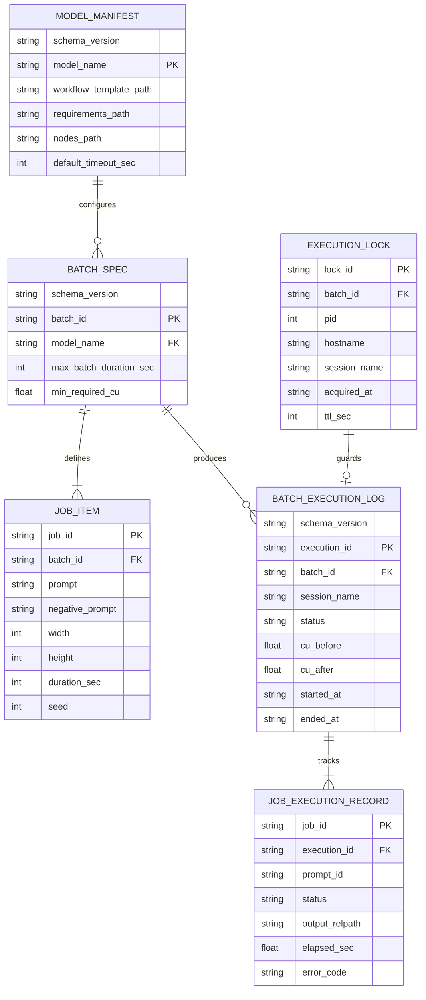

# データ構造・状態設計書（スキーマ・永続化・状態定義）
**Google Colab CLI × ComfyUI（MiniMax H3）動画自動生成パイプライン（colab-cli-comfyui-runner）**

---

## 1. 概要とデータ管理方針

### 1.1 管理対象データの目的

本設計書は、ローカルPC（Git管理領域・実行時生成ファイル）、Google Drive（5TB永続領域）、および Google Colab VM（一時配送領域）に配置・保存されるデータ構造、ディレクトリ配置、ステータス分類、原子書き込み契約、および排他ロック仕様の正本を定義する。

- **管理対象**:
  - モデル別定義（`workflows/<model_name>/` 配下のAPI用テンプレートJSON、モデルマニフェスト、依存定義）
  - バッチ入力定義（生成プロンプト群・パラメータ一覧）
  - バッチ実行状態・CU監査履歴ログ
  - 多重起動防止用ローカル排他ロックファイル
  - Google Drive 上のモデル重み資産および出力MP4ファイル配置
  - Colab VM 上の一時セットアップ配送領域（`/tmp/ccr_setup/`）
- **データ形式・文字コード・改行**: JSON / JSONL / UTF-8（BOMなし）/ LF改行（`\n`）を標準とする。設定・依存テキストファイル（`requirements.txt`, `nodes.txt`）も UTF-8（BOMなし）/ LF とする。
- **時刻の基準**: ISO 8601 形式のタイムゾーン付き文字列（例: JST `+09:00` または UTC `Z`、秒精度）で記録する。
- **スキーマの正本形式**: 本書 2.2 のフィールド定義表を正本とする。
- **機密性・個人情報分類**: Google OAuth トークン、SSH秘密鍵、ローカル環境固有の絶対パスを含む認証設定値は本書の保存ファイルおよび監査ログへ一切保存しない。

### 1.2 データ境界 (DAO / 永続化ストレージ正本)

- **本書の正本範囲**: `persistent_data`。ローカルディスク、Google Drive、およびVM配送領域に物理配置・保存されるファイル構造、スキーマ、ステータス値、原子書き込み契約、排他ロック仕様を定義する。
- **DTOとの使い分け**: メモリ上でモジュール間・関数間を受け渡す DTO の型定義は [CCR-DD-001 詳細設計書](./CCR-DD-001_詳細設計書.md) を正本とする。
- **BD/DDとの関係**: システム全体構成およびモデル重み・コード配送の分離方針は [CCR-BD-001 基本設計書](./CCR-BD-001_基本設計書.md)、制御フローとAPI通信は [CCR-DD-001 詳細設計書](./CCR-DD-001_詳細設計書.md) を正本とする。
- **他文書との関係**: 環境制約・品質ゲートは [CCR-ENV-001 環境・開発基盤仕様書](../setup/CCR-ENV-001_環境・開発基盤仕様書.md) を正本とし、本書で上書きしない。
- **責務の対象外**: ComfyUI 内部のメモリキャッシュ構造、Google Drive の認証セッション内部ファイル、`google-colab-cli` の内部設定ファイルの仕様。
- **矛盾時の扱い**: 文書の更新日ではなく、該当する `ssot_scope` の正本を更新し、関連文書を追従させる。

### 1.3 ファイル配置および階層構造

モデル重み（約42.5GB）と出力MP4のみを Google Drive へ配置し、`setup.sh` およびモデル依存定義（数KB）は実行時にローカルからVMへ配送することで、Git管理下の最新版を常に反映し Drive 側との二重管理を防ぐ。

| データ種別 | 配置場所・相対パス / 命名規則 | 保持内容 | 所有者・アクセス権 | 保持・バックアップ・復旧 |
| :--- | :--- | :--- | :--- | :--- |
| 共通制御基盤 | ローカル（Git管理）: `scripts/`（`setup.sh`, `run_batch.py` 等） | VMライフサイクル制御・API投入・セットアップスクリプト | xzyozi（Git管理） | Git履歴で管理。実行時に `setup.sh` のみVMへ配送 |
| モデル別定義一式 | ローカル（Git管理）: `workflows/<model_name>/` | `workflow_api.json`, `model_manifest.json`, 任意の `requirements.txt` / `nodes.txt` | xzyozi（Git管理） | Git履歴で管理。実行時に依存定義一式をVMへ配送 |
| バッチ入力定義 | ローカル: `batches/<batch_id>.json` | 対象モデル名、セッション上限時間、ジョブ配列（プロンプト・パラメータ） | xzyozi（ローカル読取専用扱い） | 実行者が作成・Git管理またはローカル保管 |
| 実行状態・監査ログ | ローカル: `logs/batch_<batch_id>.json` | セッション名、開始/終了CU残高、各ジョブ状態・`prompt_id`・所要時間 | xzyozi（プログラム原子書込） | 永続保持。中断時は完了済みジョブIDの識別・再実行判定に利用 |
| 月次CU履歴追記ログ | ローカル: `logs/cu_usage_history.jsonl` | バッチ単位の開始前CU・終了後CU・実消費CU・稼働時間サマリ | xzyozi（プログラム追記） | 月間200 CU枠の消化状況追跡用 |
| ローカル排他ロック | ローカル: `state/active_batch.lock` | 実行中PID、ホスト名、セッション名、取得時刻、TTL | xzyozi（制御プロセス所有） | 正常/異常終了の `finally` で削除。残存時は stale 判定後に回収 |
| Drive モデル重み資産 | Drive: `<drive_root>/models/{diffusion_models,text_encoders,vae,loras}/` | MiniMax H3 量子化モデル・エンコーダ・VAE・LoRA（約42.5GB） | xzyozi（Drive単一所有） | Google Drive 5TB上に永続保持。VMからはシンボリックリンクで参照 |
| Drive 出力成果物 | Drive: `<drive_root>/output/<model_name>/<batch_id>/` | 生成済みMP4動画（24fps・32kHzステレオ音声付き） | xzyozi（ComfyUI書込先直結） | シンボリックリンク直結により生成完了と同時に永続化 |
| VM 一時配送領域 | Colab VM: `/tmp/ccr_setup/` | ローカルから `scp`/SSH標準入力で配送された `setup.sh` およびモデル依存定義 | Colabセッション内ユーザー | VM停止（`colab stop`）と同時に自動破棄 |

---

## 2. データ構造およびスキーマ定義

### 2.1 エンティティ関係・データモデル構造 (Mermaid ER図)

### 2.2 データモデル・フィールド仕様

#### A. モデルマニフェスト（`workflows/<model_name>/model_manifest.json`）

| JSONパス / フィールド名 | データ型 | 必須性 | NULL可 | デフォルト値 | 許容値・制約条件 | 互換性・移行メモ |
| :--- | :--- | :---: | :---: | :--- | :--- | :--- |
| `$.schema_version` | 文字列 | 必須 | 不可 | `"1.0"` | `"1.0"` 固定（メジャー更新時は移行ルール適用） | 将来拡張時の判定キー |
| `$.model_name` | 文字列 | 必須 | 不可 | なし | 英小文字・数字・アンダースコア（ディレクトリ名と一致、例: `"minimax_h3"`） | 不変識別子 |
| `$.workflow_template_path` | 文字列 | 必須 | 不可 | `"workflow_api.json"` | モデルディレクトリからの相対パス（親参照 `..` 禁止） | 任意パス変更不可 |
| `$.required_drive_assets` | 配列 | 必須 | 不可 | なし | Drive相対パス（`models/...`）の非空配列。`C-002` が存在チェックとリンク作成に使用 | 新規アセット追加時は末尾追加 |
| `$.node_mappings` | オブジェクト | 必須 | 不可 | なし | `prompt`、`width`、`height`、`duration_sec`、`seed` 等の論理キーからテンプレートJSON内ノードID・フィールド名への対応表 | モデル差し替え時も共通基盤を変更せず吸収 |
| `$.default_params` | オブジェクト | 必須 | 不可 | なし | 解像度・尺・ステップ数等の既定値マップ（`CCR-DD-001` のDTO検証で上限・下限を適用） | 未指定項目の補完用 |
| `$.requirements_path` | 文字列 | 任意 | 可 | `null` | モデルディレクトリ相対パス（例: `"requirements.txt"`）。存在時のみVMへ配送・適用 | 未指定時は追加pip導入なし |
| `$.nodes_path` | 文字列 | 任意 | 可 | `null` | モデルディレクトリ相対パス（例: `"nodes.txt"`）。カスタムノードGit URL一覧ファイル | 未指定時はカスタムノード追加なし |
| `$.default_job_timeout_sec` | 数値 | 必須 | 不可 | `900` | 正の整数（秒）。1本あたり推論のタイムアウト上限 | モデル特性に応じて設定 |

#### B. バッチ入力定義（`batches/<batch_id>.json`）

| JSONパス / フィールド名 | データ型 | 必須性 | NULL可 | デフォルト値 | 許容値・制約条件 | 互換性・移行メモ |
| :--- | :--- | :---: | :---: | :--- | :--- | :--- |
| `$.schema_version` | 文字列 | 必須 | 不可 | `"1.0"` | `"1.0"` | スキーマ判定用 |
| `$.batch_id` | 文字列 | 必須 | 不可 | なし | 英数字・ハイフン・アンダースコア（1〜64文字） | 監査・出力ディレクトリ識別子 |
| `$.model_name` | 文字列 | 必須 | 不可 | なし | `workflows/<model_name>/` が実在すること | モデル切替キー |
| `$.max_batch_duration_sec` | 数値 | 必須 | 不可 | `14400` | `600` 〜 `14400`（NFR-004 2〜4時間制限準拠） | Colabセッション上限保護 |
| `$.min_required_cu` | 数値 | 必須 | 不可 | `10.0` | `0.0` より大きい数値。開始前 `colab usage` の下限閾値 | 残高不足時の誤起動防止 |
| `$.jobs` | 配列 | 必須 | 不可 | なし | 1件以上の `JOB_ITEM` オブジェクト（推奨 5〜10 件） | 順次投入対象 |
| `$.jobs[*].job_id` | 文字列 | 必須 | 不可 | なし | バッチ内で一意の文字列（1〜64文字） | 冪等・再実行識別用 |
| `$.jobs[*].prompt` | 文字列 | 必須 | 不可 | なし | 空文字不可（1文字以上） | 推論プロンプト |
| `$.jobs[*].negative_prompt` | 文字列 | 任意 | 可 | `""` | 文字列 | 任意指定 |
| `$.jobs[*].width` / `height` | 数値 | 任意 | 可 | `null` | 正の偶数。`null` 時は `model_manifest.json` 既定値を使用 | テスト960x544 / 本番1344x768 |
| `$.jobs[*].duration_sec` | 数値 | 任意 | 可 | `null` | MiniMax H3 対象範囲 `4` 〜 `15` 秒（`null` 時は既定値） | モデル別範囲はマニフェストで制御 |
| `$.jobs[*].seed` | 数値 | 任意 | 可 | `null` | 0以上の整数（`null` 時は実行時に乱数採番しログへ記録） | 再現性確保のため記録必須 |
| `$.jobs[*].input_assets` | オブジェクト | 任意 | 可 | `{}` | FL2VA開始/終了画像やRef2VA参照素材のローカルまたはDrive相対パス | 用途別任意入力 |

#### C. バッチ実行状態・監査ログ（`logs/batch_<batch_id>.json`）

| JSONパス / フィールド名 | データ型 | 必須性 | NULL可 | デフォルト値 | 許容値・制約条件 | 互換性・移行メモ |
| :--- | :--- | :---: | :---: | :--- | :--- | :--- |
| `$.schema_version` | 文字列 | 必須 | 不可 | `"1.0"` | `"1.0"` | スキーマ判定用 |
| `$.execution_id` | 文字列 | 必須 | 不可 | なし | UUID等の一意実行ID | 1回の起動ごとに採番 |
| `$.batch_id` | 文字列 | 必須 | 不可 | なし | 対象 `BATCH_SPEC.batch_id` と一致 | 相関キー |
| `$.session_name` | 文字列 | 必須 | 不可 | なし | `colab new -s <session_name>` に渡したセッション識別名 | `colab stop` / `sessions` 照合用 |
| `$.status` | 文字列 | 必須 | 不可 | `"initialized"` | 列挙値: `initialized`, `preflight_checked`, `vm_provisioning`, `env_restoring`, `running`, `stopping`, `completed`, `aborted` | 状態遷移の正本は `CCR-DD-001` |
| `$.cu_before` / `$.cu_after` | 数値 | 任意 | 可 | `null` | `0.0` 以上の数値（`cu_after` は停止後に記録） | 実消費CU = `cu_before - cu_after` |
| `$.started_at` / `$.ended_at` | 文字列 | 必須 / 任意 | 不可 / 可 | 開始時刻 / `null` | ISO 8601 タイムゾーン付き日時文字列 | `ended_at` は終端状態遷移時に設定 |
| `$.jobs` | 配列 | 必須 | 不可 | `[]` | `JOB_EXECUTION_RECORD` の配列（各ジョブの `job_id`, `prompt_id`, `status`: `pending`/`submitted`/`succeeded`/`failed`/`skipped`, `output_relpath`, `elapsed_sec`, `error_code`） | ジョブ単位に逐次更新 |

#### D. ローカル排他ロックファイル（`state/active_batch.lock`）

| JSONパス / フィールド名 | データ型 | 必須性 | NULL可 | デフォルト値 | 許容値・制約条件 | 互換性・移行メモ |
| :--- | :--- | :---: | :---: | :--- | :--- | :--- |
| `$.lock_id` | 文字列 | 必須 | 不可 | なし | UUID文字列 | 自プロセス取得分の照合キー |
| `$.batch_id` | 文字列 | 必須 | 不可 | なし | 実行中の `batch_id` | 競合時のエラーメッセージ表示用 |
| `$.pid` | 数値 | 必須 | 不可 | なし | 実行中ローカルプロセスのOS PID | 生存確認による stale 判定用 |
| `$.hostname` | 文字列 | 必須 | 不可 | なし | ローカル端末ホスト名 | 共有ドライブ等での誤判定防止 |
| `$.session_name` | 文字列 | 任意 | 可 | `null` | 確保した Colab セッション名（`colab new` 後に更新） | 残存VM調査用 |
| `$.acquired_at` | 文字列 | 必須 | 不可 | なし | ISO 8601 日時文字列 | 経過時間確認用 |
| `$.ttl_sec` | 数値 | 必須 | 不可 | `18000` | 正の整数（秒）。最大バッチ時間4時間＋起動/停止猶予1時間 | stale lock 判定基準 |

---

## 3. 永続化・原子置換契約・排他制御

### 3.1 原子的書き込み契約 (Atomic Write Contract)

`logs/batch_<batch_id>.json` の状態更新時は、異常終了やプロセス強制終了による JSON 破損を防止するため、以下の手順を必須とする。

1. **一時ファイル生成**: 対象ファイルと同一ディレクトリ内に一時ファイル（`<target>.tmp.<pid>`）を作成し、UTF-8（BOMなし）・LF で JSON 全量を書き出す。既存の一時ファイルがあれば上書きする。
2. **物理書き込み保証**: ファイルフラッシュ後に `os.fsync` を実行し、OS キャッシュからディスクへの物理書き込みを完了させる。同期失敗時は一時ファイルを削除し、正本ファイルを変更せずエラーを返却する。
3. **原子的置換**: 同一ファイルシステム上で `os.replace` を実行し、正本ファイルを原子的（アトミック）に置換する。置換失敗時は正本ファイルを無傷のまま保持し、例外を送出する。
4. **一時ファイル清掃**: 正常・異常・割り込み終了時のクリーンアップ処理で、自プロセスが生成した `.tmp.<pid>` が残存していれば削除する。
5. **復旧確認**: 次回起動時に `.tmp.*` の孤立ファイルのみが残存し正本が健全な場合は、孤立一時ファイルを破棄して正本を優先する。

- **文字コード・改行・スキーマバージョン**: UTF-8（BOMなし）・LF固定。全ルートJSONに `schema_version` を保持し、未対応バージョン読み込み時は明示的にエラー終了する。

### 3.2 排他制御仕様 (FileLock)

Google AI Pro 単一契約（月間200 CU・単一A100スポット利用前提）での多重バッチ同時起動を防止する。

- **ロック対象ファイル**: `state/active_batch.lock`
- **ロック識別情報**: `lock_id`、`batch_id`、`pid`、`hostname`、`session_name`、`acquired_at`、`ttl_sec`（機密情報は含めない）
- **ロック獲得待ち方針**: ノンブロッキング（即座に成否を判定）。長時間バッチ同士の無意味な待機による古いCU計測値での起動を防ぐため、待機キューイングは行わない。
- **取得失敗時の処理**: 既存ロックが有効な場合、実行中 `batch_id`・`pid`・`acquired_at` をエラーメッセージへ出力して即時異常終了する（VM起動は行わない）。
- **stale lock の判定・回収**: 同一ホスト上で `pid` のプロセスが存在しない、かつ経過時間が `ttl_sec` を超過している（または明示的確認で `colab sessions` に該当セッションが存在しない）場合のみ stale と判定する。自動回収は PID 不在が確実な場合に限定し、残存セッション疑いがある場合は操作者へ `colab sessions` 確認を促して中断する。
- **正常終了時の解放**: `colab stop` 完了および監査ログ確定後、自プロセスが保持する `lock_id` と一致することを確認した上でロックファイルを削除する。
- **異常終了・強制終了時の扱い**: `try ... finally` 内で可能な限り `colab stop` 後に解放する。OSクラッシュや `SIGKILL` 等で残留した場合は、次回起動時の stale lock 判定および `colab sessions` 照合により安全に回収する。

---

## 4. データライフサイクルと互換性保全

### 4.1 フォーマット移行と互換性ルール

| 移行元バージョン | 移行先バージョン | 実行契機 | 変換内容・保持する旧フィールド | ロールバック可否・方法 | 失敗時の扱い |
| :--- | :--- | :--- | :--- | :--- | :--- |
| `"1.0"` | `"1.1"`（将来拡張時） | 読み込み時・明示的互換レイヤ | 新規任意フィールドに既定値を補完し、既存必須フィールドを保持 | 可（旧JSON形式は未知キー無視または旧版維持） | 正本ファイルを変更せず、バリデーションエラーとして起動前に停止 |

- **旧バージョン互換**: 読み込み時に `schema_version` を検査し、既知の旧マイナー版であればインメモリで既定値補完を行う（入力ファイルを暗黙上書きしない）。
- **後方互換性維持**: `model_manifest.json` および `batch_<batch_id>.json` へ任意項目を追加する際は、未指定時に `null` または既定値へ安全にフォールバックする。

---

## 5. 作成完了チェック

- [x] `document_role`、`ssot_scope`、`status`、`owner`をFrontmatterへ設定した。
- [x] 管理対象、データ形式、文字コード、時刻基準、スキーマの正本形式を記入した。
- [x] 全エンティティがER図とフィールド仕様の双方に定義され、関係・カーディナリティが一致している。
- [x] 必須性、NULL可否、既定値、列挙値、制約、一意性、サイズ上限を記入した。
- [x] ファイルの相対パス、所有者・アクセス権、保持期間、バックアップ・復旧を記入した。
- [x] 原子書き込みの同期・置換・失敗・清掃・復旧契約を記入した。
- [x] FileLockの取得、待機、stale lock、解放、異常終了時の扱いを記入した。
- [x] バージョン移行、後方互換性、ロールバック、移行失敗時の扱いを記入した。
- [x] Mermaidのサンプルエンティティ・フィールド・関係および未置換のプレースホルダが残っていない。

---

## 6. 改訂履歴 (Change Log)

| 版数 | 改訂日 | 変更者 | 変更内容・変更理由 (Why) |
| :--- | :--- | :--- | :--- |
| Rev.1.0 | 2026-11-22 | xzyozi | 基本設計書（CCR-BD-001）およびVM配送方針に基づき初版作成 |
